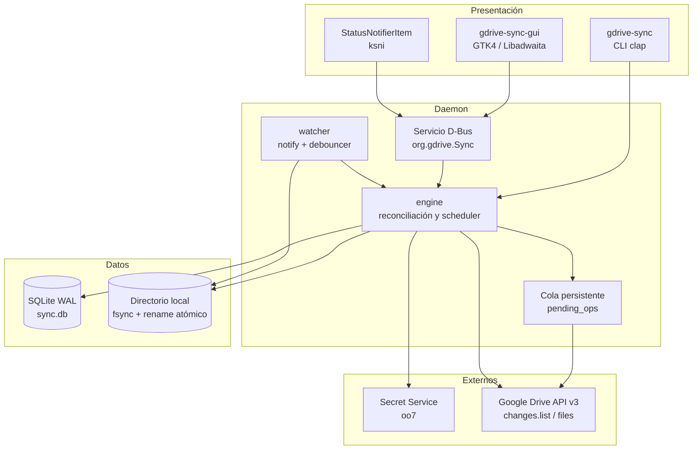
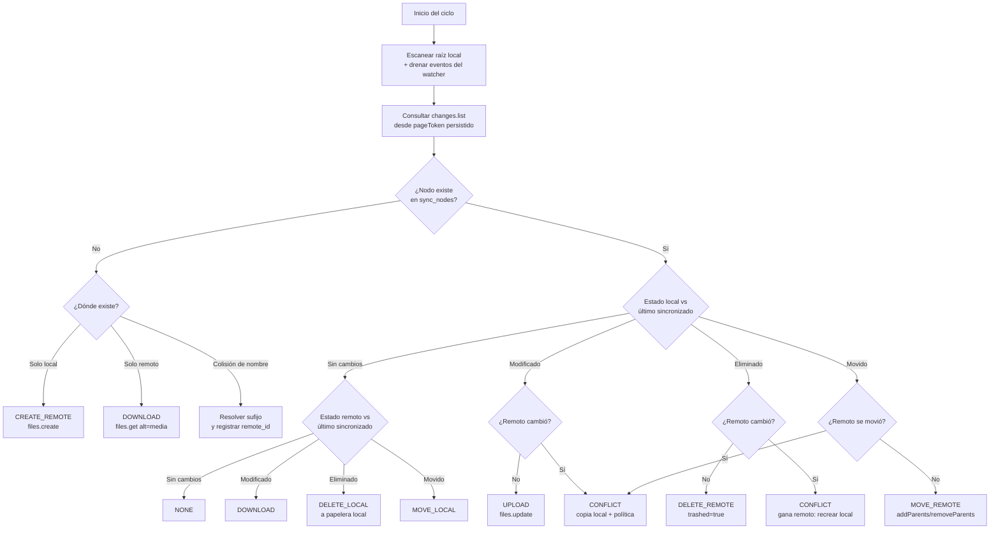
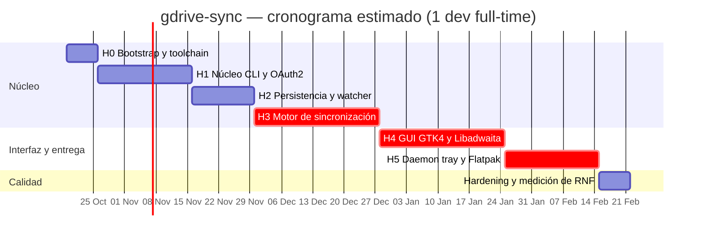

# Plan de Implementación — Cliente Nativo de Google Drive para Linux (`gdrive-sync`)

**Documento base:** `especificaci_n_t_cnica.md` (RFC de Arquitectura)
**Versión:** 1.0
**Fecha:** 2026-10-15
**Estado:** Propuesta para revisión del stakeholder

---

## 1. Resumen Ejecutivo

Este plan traduce el RFC técnico en un programa de trabajo ejecutable, organizado en **6 hitos incrementales** (H0–H5) más una fase de *hardening* y publicación. Cada hito entrega software funcional y verificable por sí mismo, de modo que el proyecto nunca dependa de un "big bang" de integración final.

**Enfoque:** construir el producto en *rebanadas verticales*. Primero el núcleo headless (autenticación → persistencia → motor de sincronización), validado por CLI y tests automatizados; luego la capa gráfica, que es un consumidor de estado y no contiene lógica de negocio. Esto permite cumplir los RNF de rendimiento (RNF-01, RNF-02) y hace el sistema testeable sin necesidad de levantar GTK ni de llamar a Google en CI.

**Esfuerzo estimado:** ≈ 18 semanas-persona para un desarrollador senior full-time. Con un segundo desarrollador incorporado desde el Hito 2 (GUI en paralelo al motor), el cronograma se comprime a ≈ 14 semanas (ver §12).

**Hallazgo principal del análisis:** el RFC es sólido en visión y arquitectura, pero **tiene cinco puntos que deben resolverse antes de escribir código**, porque impactan el esquema de datos, el motor o los criterios de aceptación (ver §3, ADR-001 a ADR-009). Resolverlos después del Hito 3 implicaría reescritura. Estos son:

1. La **matriz de decisiones de sincronización no contempla eliminaciones ni renombrados/movimientos** — es decir, no cubre dos de los tres eventos que `inotify` reporta y que `changes.list` entrega. Sin esas filas, la sincronización bidireccional queda incompleta (RF-05) y acumula divergencia.
2. El **esquema SQLite es insuficiente** para el motor: no persiste el `pageToken` de `changes.list` (RF-04 queda sin estado entre ejecuciones), no distingue el checksum remoto del último sincronizado (imposible detectar cambios de ambos lados), no soporta múltiples carpetas sincronizadas y declara `local_path` único global, lo que impide representar homónimos (Google Drive permite nombres duplicados).
3. La **elección de scope OAuth** es una decisión de producto con impacto bloqueante: sincronizar archivos preexistentes exige el scope restringido `drive`, y Google somete ese scope a un proceso de verificación y evaluación de seguridad para distribuir la app a terceros. Esto condiciona el Hito 5 (publicación en Flathub).
4. Las **versiones del stack sugerido están desactualizadas** y algunas de las más recientes son *incompatibles entre sí*. Todas fueron verificadas contra crates.io el 2026-10-16 (Anexo C): gtk4 0.8 → **0.11.5**, libadwaita 0.6 → **0.9.2**, reqwest 0.11 → **0.13.5**, oauth2 4.4 → **5.0.0**, notify 6.1 → **8.2.0**, rusqlite 0.30 → **0.40.2**. Dos trampas concretas: `oauth2` 5.0 depende de `reqwest ^0.12` y el proyecto usaría 0.13 (ADR-009), y **`zbus` debe fijarse en 5.x aunque la última versión sea 6.0.0**, porque `oo7` 0.6 y `ksni` 0.3.6 exigen `^5`. El MSRV resultante es **1.92** (lo imponen `gtk4` 0.11, `glib`/`gio` 0.22 y `oo7` 0.6).
5. El **umbral de RNF-01 (≤ 80 MB) es inalcanzable tal como está redactado** si el motor de sincronización convive con GTK4. Medición real en el equipo de desarrollo (3 muestras estables): `gnome-calendar` (GTK4 + libadwaita) = 68 MB RSS / 29 MB PSS, y `amberol` (**también Rust + gtk4-rs**, nuestro mismo stack) = 140 MB RSS / 113 MB PSS. El RNF-01 se reformuló como **presupuesto escalonado por proceso** (§11), lo que preserva su intención real (que el núcleo que sincroniza sea liviano) sin exigirle a GTK4 un mínimo que no puede cumplir.

---

## 2. Alcance

### 2.1 En alcance (v1.0)

| ID | Requerimiento | Hito responsable |
| --- | --- | --- |
| RF-01 | Autenticación OAuth2 con PKCE vía navegador | H1 |
| RF-02 | Persistencia de tokens en Secret Service (*Gnome Keyring*) | H1 |
| RF-03 | Monitoreo local en tiempo real (`inotify`) | H2 |
| RF-04 | Detección remota de cambios (`changes.list`) | H2 |
| RF-05 | Sincronización bidireccional | H3 |
| RF-06 | Resolución de conflictos por copia local | H3 |
| RF-07 | Interfaz gráfica GTK4 / Libadwaita | H4 |
| RF-08 | Indicador de bandeja (StatusNotifierItem) | H5 |
| RNF-01 | Memoria RAM: daemon en reposo ≤ 50 MB, bajo carga ≤ 150 MB, GUI ≤ 200 MB, total ≤ 250 MB (§11) | H5 (medido desde H2) |
| RNF-02 | CPU ≤ 1 % en reposo | H2 (validado en H5) |
| RNF-03 | Concurrencia con `tokio` | H3 |
| RNF-04 | Cumplimiento de GNOME HIG | H4 |
| RNF-05 | Reintentos con *exponential backoff* | H1 (base) / H3 (endurecido) |
| — | Empaquetado Flatpak | H5 |

### 2.2 Fuera de alcance (v1.0)

Declararlo explícitamente evita ambigüedad en la aceptación:

- **Google Docs/Sheets/Slides nativos** (requieren `files.export` y formato de conversión). En v1.0 se detectan y se marcan como *no sincronizables* con un aviso en la UI.
- **Shared Drives** (`driveId`, `supportsAllDrives`). El diseño los deja aislados tras una bandera de configuración, pero no se prueban.
- **Sincronización selectiva** por archivo, glob o exclusión por tamaño (solo se implementan patrones de exclusión globales tipo `.gitignore`).
- **Push notifications** (`changes.watch` + webhook). Se documenta como optimización post-v1.0 (§3, ADR-008).
- **Multi-cuenta simultánea** (una cuenta activa a la vez; el modelo de datos ya la soporta).
- **Cifrado del lado del cliente**, historial de versiones del usuario, y plataformas no Linux.

### 2.3 Supuestos

1. El usuario tiene una cuenta de Google con capacidad de crear un proyecto en Google Cloud Console y credenciales OAuth tipo *Desktop app* (no es un requisito de la app, sino del despliegue; se documentará en el README).
2. El directorio sincronizado reside en un filesystem con soporte de `inotify` y *rename* atómico (`ext4`, `btrfs`, `xfs`). En `exFAT`/`NTFS` se advierte la pérdida de precisión de timestamps.
3. Se dispone de conexión a Internet intermitente; el sistema debe degradarse de forma controlada (RNF-05).
4. El equipo adopta las reglas de branching y commits descritas en §9.

### 2.4 Prerrequisitos de entorno (estado verificado de la máquina de desarrollo)

Verificación de entorno ejecutada el 2026-10-15; versiones de crates y medición de memoria de apps GTK4, el 2026-10-16:

| Componente | Estado | Acción requerida |
| --- | --- | --- |
| `rustc` / `cargo` | **Ausente** | Instalar toolchain vía `rustup` (T0.1). **MSRV requerido: 1.92** |
| Rust estable actual | **1.99.1** (2026-10-13) | Suficiente; fijar `rust-version = "1.92"` en `Cargo.toml` |
| `libgtk-4-dev` | **Ausente** | Instalar (T0.2) |
| `libadwaita-1-dev` | **Ausente** | Instalar (T0.2) |
| `libsqlite3-dev` | **Ausente** | Opcional: `rusqlite` con feature `bundled` compila SQLite embebido |
| `pkg-config`, `gcc` | Presente (gcc) | `pkg-config` requerido por `-sys` crates |
| `flatpak`, `flatpak-builder` | Presentes | Listo para H5 |
| Runtime `org.gnome.Platform` | Disponibles 48, 49, 50 y 51 en Flathub | Fijar rama en H5 (T5.5); verificar versión de GTK/libadwaita del runtime (Anexo F) |
| Repositorio Git | **No inicializado** | `git init` (T0.6) |

Comandos de referencia (Fedora):

```bash
sudo dnf install gtk4-devel libadwaita-devel pkgconf-pkg-config gcc sqlite-devel
curl --proto '=https' --tlsv1.2 -sSf https://sh.rustup.rs | sh
```

---

## 3. Brechas Detectadas y Decisiones Arquitectónicas (ADR)

Cada ADR es una decisión **propuesta**; las marcadas con ⚠️ requieren confirmación del stakeholder (§13.F).

### ADR-001 — Extender la matriz de decisiones de sincronización

**Contexto.** El RFC define 6 filas en la matriz (§4.4), todas de creación o modificación. No define qué hacer cuando un archivo se elimina en local y/o en remoto, ni cuando se renombra o mueve. Como el watcher mapea `Create`, `Modify`, `Remove` y `Rename`, y `changes.list` reporta `removed: true` y cambios de `parents`, **el motor no tiene una acción definida para la mayoría de los eventos reales**.

**Decisión.** Adoptar la matriz extendida de 14 filas del Anexo B. Reglas de oro:

- **Sin pérdida de datos:** ante ambigüedad (p. ej. modificado en local + eliminado en remoto), gana la operación que preserva contenido, y el resultado se registra como conflicto.
- **Eliminación remota = `trashed: true`** (papelera de Drive, reversible 30 días) por defecto; borrado permanente solo si el usuario lo habilita.
- **Eliminación local = mover a `.gdrive-sync-trash/`** dentro de la raíz con retención de 30 días, no `unlink`.
- **Renombrado/movimiento** se resuelve como `files.update` con `addParents`/`removeParents` + `name`, nunca como *delete + create* (preservar `fileId` evita romper enlaces compartidos).

**Impacto.** Afecta a `engine`, al esquema de `sync_nodes` (ADR-002) y a la suite de tests parametrizada (§8.3). Es la decisión de mayor retorno del plan.

### ADR-002 — Reemplazar el esquema de base de datos por un esquema v1 completo

**Contexto.** El esquema del RFC (§4.3) no permite implementar RF-04 ni RF-06 de forma correcta:

- No hay lugar para el `pageToken` de `changes.list` → sin él, cada arranque re-escanea toda la nube o pierde cambios.
- `md5_checksum` (una sola columna) no distingue *checksum remoto* de *checksum local en la última sincronización*; sin esos dos valores es imposible aplicar las filas 3 y 4 de la matriz.
- `local_path UNIQUE` es global: impide tener dos raíces sincronizadas y no contempla que Drive admite nombres duplicados en la misma carpeta.
- No existe cola de operaciones → tras un *crash* con transferencias en vuelo, el estado queda inconsistente.
- No hay tabla de conflictos → RF-06 no es auditable ni resoluble por el usuario desde la GUI.
- `last_modified_local INTEGER NOT NULL` sin unidad ni zona horaria; `INTEGER` en SQLite no es `TIMESTAMP` y mezclar `CURRENT_TIMESTAMP` (texto UTC) con enteros produce comparaciones silenciosamente erróneas.

**Decisión.** Adoptar el esquema del Anexo A (migración `0001_init.sql`): se conserva `sync_nodes` como núcleo (compatibilidad conceptual con el RFC) y se agregan `sync_state`, `sync_roots`, `pending_ops` y `conflicts`. Convenciones:

- Todos los timestamps se almacenan como **epoch en milisegundos UTC (`INTEGER`)**; el formato texto queda solo para metadatos legibles.
- `local_path` se guarda **relativo a la raíz**, con `UNIQUE (root_id, local_path)`.
- Checksums: **SHA-256** como algoritmo primario (`sha256Checksum` de Drive cuando exista; `md5Checksum` como *fallback*).
- SQLite en modo **WAL** con `busy_timeout = 5000` y `foreign_keys = ON`.
- Migraciones versionadas y aplicadas en transacción (`rusqlite_migration` o runner propio sobre `user_version`).

**Impacto.** `db`, `engine`, `watcher`. Se implementa en H2 antes del motor, que es quien consume el esquema.

### ADR-003 — Detección de cambios remotos por metadatos compuestos, no por timestamp

**Contexto.** Usar solo `modifiedTime` produce falsos negativos/positivos: cambios dentro del mismo segundo, `modifiedTime` alterable por el cliente (`files.update` permite fijar `modifiedTime`) y relojes de dispositivos desincronizados.

**Decisión.** Un cambio remoto se detecta si **cualquiera** de estos difiere respecto de lo registrado: `sha256Checksum`/`md5Checksum`, `version`, `size` + `modifiedTime`. Se persiste `remote_version` (contador monótono del servidor, válido también para cambios no visibles al usuario) y `remote_checksum`.

**Limitación conocida (documentar en UI y README).** Los archivos de Google Docs/Sheets/Slides **no exponen checksum** (`sha256Checksum` no se completa para Docs Editors) y están fuera de alcance (v1.0 los marca como no sincronizables). Los *shortcuts* tampoco reportan checksum ni `size`.

### ADR-004 — Separar el motor de sincronización del proceso de GUI ⚠️

**Contexto.** El RFC presenta un único proceso con 4 capas. Un cliente de sincronización debe seguir sincronizando con la ventana cerrada (el propio RFC lo implica al pedir un ícono de bandeja, RF-08) y debe respetar RNF-01 y RNF-02 (≤ 1 % CPU en reposo). Mantener GTK4 cargado en el proceso que sincroniza hace el objetivo de memoria innecesariamente frágil, y **la medición lo confirma**: en el equipo de desarrollo, `gnome-calendar` (GTK4 + libadwaita, app mínima) consume 68 MB RSS en reposo y `amberol` (app Rust/gtk4-rs, el mismo stack que este proyecto) consume **140 MB RSS / 113 MB PSS**. Un proceso que además indexe 10 000 nodos en SQLite y mantenga 4 transferencias en vuelo no puede caber en 80 MB.

**Decisión.** Dos binarios en un mismo workspace:

- `gdrive-sync-daemon` — headless, posee `db` + `watcher` + `engine`, se expone por **D-Bus** (`org.gdrive.Sync`) en el bus de sesión y se autoinicia vía `.desktop` en `~/.config/autostart`.
- `gdrive-sync-gui` — GTK4/Libadwaita, consume el daemon por D-Bus; si el daemon no está activo, D-Bus lo lanza por *service activation*.
- `gdrive-sync` (CLI) — mismo núcleo, sin GUI, útil para desarrollo, *scripting* y para el Hito 1.

El presupuesto de memoria de RNF-01 se reparte entre procesos según §11: el daemon headless es el que debe ser liviano (≤ 50 MB en reposo), porque es el que corre siempre y el que impacta RNF-02.

**Alternativa considerada y descartada para v1.0:** proceso único con la GUI como capa superior. Es más simple (menos IPC) pero impide cumplir RF-08 + RNF-01 de forma robusta y obliga a mantener una bandera "headless" que duplica caminos de código.

**Mitigación de riesgo.** El Hito 3 entrega el motor *embebido en el CLI*; la extracción a daemon en H5 es un refactor de empaquetado, no una reescritura, porque el motor nunca depende de GTK.

### ADR-005 — Scope OAuth: `drive` (restringido) con `client_id` propio ⚠️

**Contexto.** `drive.file` solo da acceso a archivos creados o abiertos por la app; **no sirve** para sincronizar un directorio con archivos preexistentes del usuario. El scope `https://www.googleapis.com/auth/drive` es *restringido*, y Google exige verificación de la app + evaluación de seguridad de terceros para publicarla. Mientras la app esté en modo *Testing*, funciona sin verificación pero limitada a usuarios de prueba (límite de 100 usuarios de prueba).

**Decisión.** Usar `https://www.googleapis.com/auth/drive` para v1.0 y ser explícitos en el README y en la pantalla de login: **cada usuario compila/provee su propio `client_id`** (modelo *bring-your-own-client-id*), documentado en `docs/GOOGLE_SETUP.md`. Esto desacopla el proyecto de la verificación de Google y es viable para uso personal/autoalojado.

**Consecuencia para H5.** La publicación en Flathub de una app que requiere `client_id` del usuario es posible, pero la experiencia de primer uso deberá guiar al usuario por la creación del proyecto en Cloud Console. Si el objetivo de producto es distribución masiva sin fricción, el proyecto debe presupuestar el proceso de verificación de Google (semanas, no días) — **decisión de producto pendiente (§13.F)**.

### ADR-006 — Flujo OAuth2 para app nativa: loopback en puerto efímero

**Contexto.** El RFC fija `http://127.0.0.1:8080/callback`. Un puerto fijo colisiona con cualquier servicio del usuario y es un antipatrón en apps de escritorio. Además, el flujo OOB (`urn:ietf:wg:oauth:2.0:oob`) está discontinuado.

**Decisión.**

- Redirect URI **loopback con puerto efímero**: el listener se ata a `127.0.0.1:0`, se lee el puerto asignado y se envía ese valor como `redirect_uri`. Google acepta el puerto variable para clientes tipo *Desktop app*.
- **PKCE obligatorio** (`S256`): `code_verifier` de 43–128 caracteres con CSPRNG, `code_challenge = BASE64URL(SHA256(verifier))`.
- `state` aleatorio validado al recibir el callback; el listener responde 200 con una página mínima y se cierra inmediatamente (timeout duro de 5 minutos).
- El listener **solo escucha en `127.0.0.1`**, nunca `0.0.0.0`.
- El navegador se abre con `xdg-open` (en Flatpak: `gio open` / portal `OpenURI`).
- Google exige un `client_secret` incluso en clientes *Desktop app*; se trata como **valor no confidencial** (la seguridad real la aporta PKCE) y se lee de configuración, nunca se embebe en el código fuente.
- `access_type=offline` + `prompt=consent` en el primer login para obtener `refresh_token`.
- **Sin redirecciones HTTP (prevención de SSRF):** la documentación de `oauth2` advierte explícitamente que el cliente HTTP debe configurarse para **no seguir redirecciones**, para evitar SSRF en el flujo de token. Por eso el cliente `reqwest` del módulo `auth` se construye con `redirect::Policy::none()`. Se cubre con un test en T1.2.

### ADR-007 — Watcher: `notify` + `notify-debouncer-full`, con exclusiones

**Contexto.** El RFC propone un *debounce* manual de 500 ms. El *debounce* manual naive es la fuente habitual de bugs en sincronizadores: pierde el `RenameEvent` emparejado (`from`/`to`), y en editores que hacen *write-to-temp + rename* (Vim, VS Code, LibreOffice) genera un `Remove` falso que dispara una eliminación remota destructiva.

**Decisión.**

- Usar `notify` (8.x) con el backend inotify, y `notify-debouncer-full` (0.7) que **empareja eventos de renombrado** y agrupa ráfagas.
- Ventana de *debounce* de **500 ms** por defecto, configurable por `config.toml`.
- **Ignorar** archivos temporales de editores (`*.swp`, `*~`, `*.tmp`, `*.crdownload`, `*.part`, `4913`), el directorio interno `.gdrive-sync-tmp/` (staging) y `.gdrive-sync-trash/`.
- **Estabilidad previa a la subida:** además del *debounce*, verificar que el tamaño no cambia durante 2 muestras separadas 250 ms antes de transferir (evita subir archivos parciales, tal como pide el RFC §4.2).
- **Límite de inotify:** un watch por directorio. Monitorear el consumo contra `fs.inotify.max_user_watches`; si el escaneo inicial detecta más de 80 % del límite, degradar a *polling* de 30 s en los subárboles excedentes y advertir al usuario (documentar `sudo sysctl fs.inotify.max_user_watches=524288`).
- **Reconciliación al arrancar:** `inotify` no ve cambios ocurridos con la app cerrada; al iniciar se ejecuta un *scan* completo de la raíz y un `changes.list` desde el `pageToken` persistido.

### ADR-008 — Sincronización remota basada en `changes.list` con `pageToken` persistido

**Contexto.** `changes.list` requiere un `pageToken` obtenido de `changes.getStartPageToken` y devuelve `newStartPageToken` al final de la última página. El token caduca si cambia el conjunto de cambios soportados o si el usuario revoca el acceso; hay que recomenzar.

**Decisión.**

- Persistir `changes_page_token` en `sync_state` y **actualizarlo solo cuando la página se procesa por completo** (avance monotónico; nunca retroceder ante un error a mitad de página).
- `pageSize = 1000` (máximo), `fields` explícito (`nextPageToken,newStartPageToken,changes(fileId,removed,time,changeType,file(id,name,mimeType,size,parents,modifiedTime,md5Checksum,sha256Checksum,version,trashed))`) para minimizar payload.
- `includeRemoved=true`, `spaces=drive`, `restrictToMyDrive=true`.
- **Fallback:** si `changes.list` devuelve `400/410` (token inválido/caducado), descartar el token y ejecutar una **reconciliación completa por `files.list` recursivo** sobre el `remote_folder_id` de la raíz, comparando contra `sync_nodes`. Este mismo camino resuelve el primer *login* sobre una carpeta ya existente.
- Post-v1.0: `changes.watch` con webhooks reduce la latencia y el consumo (documentado, no implementado).

### ADR-009 — Alineación de dependencias y conflicto `oauth2` ↔ `reqwest` ⚠️

**Contexto.** `oauth2` 5.0 habilita por defecto un cliente `reqwest` declarado contra `reqwest ^0.12`. El proyecto usa `reqwest` 0.13.5. Dejar esa feature activa introduce **dos versiones mayores de `reqwest` y de todo su árbol TLS** en el binario (bloat, superficie de auditoría duplicada y riesgo de fallo de build en Flatpak).

**Decisión.** Usar `oauth2` 5.0 con `default-features = false`. La viabilidad está **verificada en la documentación oficial de la crate**: sin cliente HTTP, `oauth2` ofrece la interfaz `AsyncHttpClient`, que se implementa automáticamente para cualquier closure `Fn(HttpRequest) -> Future<Output = Result<HttpResponse, E>>`, y los tipos `oauth2::HttpRequest` / `oauth2::HttpResponse` son alias sobre `http` 1.x — exactamente los tipos que maneja `reqwest` 0.13. Por lo tanto, el cliente HTTP propio (que ya centraliza *timeouts*, reintentos, observabilidad y `redirect::Policy::none()` para el control de SSRF de ADR-006) se reutiliza para el flujo de token sin costo adicional.

**Alternativas descartadas:**
- Bajar todo el proyecto a `reqwest` 0.12 para usar la feature integrada: se descarta para no arrastrar una versión con menor soporte.
- Usar `ureq` o `curl` (features de `oauth2`): introducirían un **segundo cliente HTTP** solo para el *login*, duplicando el stack TLS y el manejo de errores.

**Verificación obligatoria en T1.2:** `cargo tree -d` no debe reportar duplicación de `reqwest`, `hyper` ni del backend TLS, y debe existir un test que compruebe que el cliente no sigue redirecciones.

### ADR-013 — Política de versiones y deduplicación del árbol de dependencias

**Contexto.** El RFC declara versiones "sugeridas" que en varios casos ya no son actuales, y la verificación contra crates.io (2026-10-16) mostró dos problemas distintos: versiones desactualizadas y, más importante, que **la versión más nueva no siempre es la correcta**. El caso testigo es `zbus`: la última es 6.0.0, pero `oo7` 0.6 (RF-02) y `ksni` 0.3.6 (RF-08) exigen `zbus ^5`, de modo que elegir 6.0.0 duplicaría todo el stack D-Bus en el binario. En un proyecto con ~30 dependencias directas y GTK4 en el árbol, la disciplina de versiones es un requisito de mantenimiento, no un detalle.

**Decisión.**

1. **MSRV declarado y verificado:** `rust-version = "1.92"` en el workspace, impuesto por `gtk4` 0.11, `glib`/`gio` 0.22 y `oo7` 0.6. `rust-toolchain.toml` fija el canal; CI compila con la toolchain fija (estable actual 1.99.1).
2. **Versiones centralizadas:** todas las dependencias se declaran en `[workspace.dependencies]` y los crates internos las heredan con `workspace = true`. Ninguna versión se repite en un `Cargo.toml` de crate.
3. **Rangos semver, no pines exactos** (`gtk4 = "0.11"`), y **`Cargo.lock` versionado** (es un binario, no una librería): reproducibilidad por *lock*, flexibilidad por rango.
4. **Regla de desempate: primero deduplicar, después actualizar.** Ante dos versiones compatibles de una misma crate, se elige la que comparte el grafo existente. Excepción documentada: `sha2` (el proyecto usa 0.11.1; `oauth2` y `oo7` traen 0.10) — se acepta el duplicado por ser una crate pequeña y sin estado compartido, y se revisará cuando ambas converjan.
5. **Gate de CI:** `cargo deny check` (licencias, avisos, *bans*) y revisión de `cargo tree -d`. Se prohíben duplicados de `reqwest`, `hyper`, `rustls`/`native-tls`, `zbus` y `rusqlite`; cualquier otro duplicado debe justificarse en el PR.
6. **Excepciones que no se autoactualizan:** `gtk4`, `libadwaita`, `zbus` y `notify`+`notify-debouncer-full` se actualizan solo con revisión manual, porque su versión está atada a la API de GTK, a la versión de libadwaita del runtime, o a la pareja `notify` ↔ `notify-debouncer-full`. No se aceptan PRs automáticos de *bots* sobre ellas.

**Consecuencias.** El proyecto queda deliberadamente una mayor detrás de `zbus` (5.x) mientras `oo7`/`ksni` no migren; cuando lo hagan, se actualizan juntos (ADR-013 punto 6). El Anexo C es el registro operativo de estas decisiones y debe actualizarse en el mismo PR que cambie una dependencia.

**Avisos aceptados (verificado en H0 con `cargo-deny` 0.20.2).** El stack `zbus` 5.x arrastra tres avisos **`unmaintained`** (no vulnerabilidades): `RUSTSEC-2026-0370` (`zbus_names`), `RUSTSEC-2026-0371` (`zvariant`) y `RUSTSEC-2026-0372` (`zvariant_derive`). Sus macros se integraron en `zbus` 6, pero `oo7` 0.6 **y también `oo7` 0.7.0-beta** exigen `zbus ^5.19`, y `ksni` 0.3.6 exige `^5`. Además, `oo7` 0.7.0-beta sube el MSRV a 1.95. Por eso se ignoran explícitamente y con motivo en `deny.toml`: **cualquier aviso nuevo sigue bloqueando el merge**. Condición de salida: al migrar a `zbus` 6, eliminar las tres entradas de `deny.toml` en el mismo PR.

### ADR-010 — Nombres y rutas: sanitización, colisiones y cambios de tipo

**Contexto.** Drive admite nombres que Linux no admite y viceversa: `/`, longitud > 255 bytes, nombres terminados en punto o espacio, `.`/`..`, homónimos en la misma carpeta, y *shortcuts*.

**Decisión.**

- Al **descargar**, sanitizar el nombre remoto (`/` → `_`, truncar a 200 bytes preservando extensión, eliminar caracteres de control) y persistir la diferencia en `remote_name` para poder hacer *round-trip* en renombrados.
- Ante **homónimos**, resolver con sufijo determinista `nombre (2).ext` y registrar `remote_id` → ruta, evitando que dos nodos apunten a la misma ruta.
- Al **subir**, si el nombre local tiene caracteres aceptados por Drive (que es permisivo), se sube tal cual.
- **Validación de seguridad:** ninguna ruta derivada de metadatos remotos puede escapar la raíz. Se canonicaliza y se verifica el prefijo antes de toda escritura (defensa contra *path traversal* mediante nombres como `../../.ssh/authorized_keys`).
- **Cambio de tipo** (archivo → carpeta o viceversa para el mismo nodo) es un caso no resoluble automáticamente: se marca `CONFLICT` y se presenta en la UI.
- **Symlinks:** no se siguen; se omiten con un aviso (evita ciclos y *escape* de la raíz).

### ADR-011 — Observabilidad sin filtrar secretos

**Contexto.** Un sincronizador con *backoff* y reintentos es difícil de diagnosticar sin logs, pero los logs son justamente donde se filtran `access_token`/`refresh_token`.

**Decisión.** `tracing` + `tracing-subscriber` + rotación diaria en `$XDG_STATE_HOME/gdrive-sync/logs/`. Nivel `info` por defecto, `debug`/`trace` activables por CLI (`-v`) y por variable de entorno (patrón EnvFilter). **Regla dura:** los tipos `AccessToken`/`RefreshToken` implementan `Debug` enmascarado (`***`) y el log de peticiones HTTP redacta `Authorization`, `client_secret`, `code` y `refresh_token`. Se añade un test que falla si un token real aparece en la salida de log. Nada de telemetría remota.

### ADR-012 — Bandeja del sistema: StatusNotifierItem con degradación elegante

**Contexto.** GNOME Shell **no** muestra íconos de bandeja sin la extensión *AppIndicator and KStatusNotifierItem Support*; es una decisión de diseño de GNOME, no un bug. Además, en Flatpak el acceso al *watcher* de StatusNotifier requiere permisos de bus explícitos.

**Decisión.**

- Implementar StatusNotifierItem con `ksni` (versión 0.3.6; alternativa `libappindicator` 0.9.0, peor mantenida).
- **Detectar** en tiempo de ejecución si hay un `org.kde.StatusNotifierWatcher` en el bus; si no lo hay, la app funciona igual y comunica el estado por **notificaciones** (`Gio::Notification`), y la ventana permanece accesible vía `--hidden`/autostart.
- Permisos Flatpak: `--talk-name=org.kde.StatusNotifierWatcher`.
- Nunca depender del tray para el control: la ventana y el CLI exponen todas las acciones (pausar, reanudar, resolver conflictos).

---

## 4. Arquitectura Objetivo

### 4.1 Diagrama de componentes



### 4.2 Estructura del workspace (crates)

```
gdrive-sync/
├── Cargo.toml                  # workspace: [workspace.dependencies] con versiones centralizadas
├── rust-toolchain.toml         # toolchain fijada (MSRV de gtk4-rs)
├── rustfmt.toml · clippy.toml · deny.toml · .editorconfig
├── crates/
│   ├── core/     # Tipos de dominio, estados, matriz de decisión, traits (DriveApi, TokenStore, Clock)
│   ├── auth/     # OAuth2 PKCE, listener loopback, oo7 (token store), refresh
│   ├── drive/    # Cliente REST v3, retry/backoff, rate limiter, uploads multipart/resumable
│   ├── db/       # rusqlite, migraciones, DAOs, consultas de reconciliación
│   ├── watcher/  # notify + notify-debouncer-full, exclusiones, mapeo a LocalSyncEvent
│   ├── engine/   # Reconciliación, planificador, ejecutor de ops, conflictos
│   ├── ipc/      # Interfaz D-Bus (zbus) + definición de tipos de evento (H5)
│   ├── cli/      # bin: gdrive-sync
│   ├── daemon/   # bin: gdrive-sync-daemon (H5)
│   └── gui/      # bin: gdrive-sync-gui (H4) — siempre detrás de feature `gui` para builds headless
├── data/
│   ├── migrations/0001_init.sql
│   ├── org.gdrive.Sync.service · org.gdrive.Sync.xml
│   ├── gdrive-sync.desktop · io.github.gdrive_sync.metainfo.xml
│   └── icons/
├── flatpak/  org.gnome.Platform · io.github.gdrive_sync.json
├── docs/     GOOGLE_SETUP.md · ARCHITECTURE.md · INSTALL.md · TROUBLESHOOTING.md · PERFORMANCE.md · PRIVACY.md · adr/
├── scripts/  bootstrap.sh · measure-resources.sh
└── tests/    fixtures/  (respuestas JSON de Drive anonimizadas)
```

**Justificación:** el `core` sin dependencias de GTK ni de red es lo que permite testear la matriz de decisión (el corazón del producto) con tests de tabla puros y sin *mocks*. `drive` detrás de un trait permite sustituir la API real por `wiremock` en integración y por un *fake* en unitarios.

### 4.3 Modelo de eventos (contrato interno)

Tipos definidos en `crates/core/src/events.rs` (identificadores en inglés, según estándar del equipo):

| Canal | Tipo | Productores → Consumidor |
| --- | --- | --- |
| `mpsc` | `LocalSyncEvent { path, kind: Created/Modified/Removed/Renamed{from,to} }` | `watcher` → `engine` |
| `mpsc` | `RemoteChange { file_id, removed, change_type, file: Option<FileMetadata> }` | `drive` → `engine` |
| `mpsc` | `EngineCommand { Pause, Resume, Resolve(node_id, Resolution), RescanRoot(root_id), Shutdown }` | `cli`/`ipc` → `engine` |
| `mpsc` | `TransferProgress { op_id, bytes_done, bytes_total, direction }` | `engine` → `ipc`/UI |
| *broadcast* | `EngineState { Idle, Syncing{pending}, Offline{retry_in}, Conflict{count}, Error{..} }` | `engine` → UI/tray |

### 4.4 Ciclo de reconciliación

Se ejecuta (a) al arrancar, (b) cuando el watcher emite eventos tras el *debounce* y (c) cuando `changes.list` reporta cambios. Una sola ejecución a la vez (actor único, `tokio::sync::mpsc` como buzón) para serializar escrituras de estado.



### 4.5 Transferencias y concurrencia (RNF-03)

- **Pool de transferencias:** `Semaphore` con `max_concurrent_transfers = 4` (configurable).
- **Límite de peticiones:** *token bucket* global (p. ej. 8 req/s de partida, ajustable tras medir cuotas) + *jitter*.
- **Umbral de subida:** `size ≤ 5 MiB` → `uploadType=multipart` (`POST /upload/drive/v3/files` para crear, `PATCH /upload/drive/v3/files/{fileId}` para actualizar). `> 5 MiB` → `uploadType=resumable` con *chunks* de 8 MiB (múltiplos de 256 KiB, requerido por Drive para reanudar).
- **Nunca cargar un archivo completo en memoria:** cuerpo en *streaming* (`reqwest::Body::wrap_stream` sobre `tokio::fs::File`), chunked con `tokio-util::io::ReaderStream`. Esto es requisito directo de RNF-01.
- **Descargas:** *streaming* a `.gdrive-sync-tmp/<uuid>.part`, verificación de checksum, `fsync`, `rename()` atómico al destino final (mismo filesystem), y solo entonces `commit` en SQLite. El orden "escribir archivo → commit de estado" garantiza que un *crash* nunca marca como sincronizado algo que no está en disco.
- **Escritor único de SQLite:** todas las mutaciones pasan por el actor del engine (evita `SQLITE_BUSY` y condiciones de carrera).
- **Cancelación:** cada transferencia corre en una `JoinHandle` con `CancellationToken` (`tokio-util`) para pausar con rapidez.

### 4.6 Política de reintentos y clasificación de errores (RNF-05)

| Condición | Clasificación | Acción |
| --- | --- | --- |
| Error de red / timeout / DNS | Retryable | Backoff exponencial, base 2 s, ×2, tope 5 min, *jitter* ±20 %, máx. 8 intentos → estado `Offline` y reintento periódico |
| `401 Unauthorized` | Auth | `refresh_token`, 1 reintento inmediato; si falla → `Error` y pedir re-login |
| `403 rateLimitExceeded` / `userRateLimitExceeded` | Retryable | Backoff; reducir el *token bucket* a la mitad |
| `403 forbidden` / `insufficientPermissions` | Fatal | Estado `Error` en el nodo, aviso en UI |
| `429 Too Many Requests` | Retryable | Respetar cabecera `Retry-After` |
| `5xx` | Retryable | Backoff |
| `404 Not Found` | Reconciliación | El recurso remoto ya no existe → recomputar estado del nodo |
| `409` en subida resumable | Reanudable | Consultar offset con `Content-Range: bytes */total` y continuar |
| Checksum no coincide tras descarga | Retryable | Reintentar descarga (máx. 3) → `Error` |

Los reintentos se persisten en `pending_ops.attempt_count` y `next_attempt_at`, de modo que **sobreviven al reinicio del daemon** (requisito no explícito del RFC pero imprescindible para RF-05).

---

## 5. Layout de Datos en el Sistema de Archivos del Usuario

| Ruta | Contenido |
| --- | --- |
| `$XDG_CONFIG_HOME/gdrive-sync/config.toml` | `client_id`/`client_secret`, raíces sincronizadas, `debounce_ms`, `max_concurrent_transfers`, política de conflictos, política de eliminación |
| `$XDG_DATA_HOME/gdrive-sync/sync.db` (+ `-wal`, `-shm`) | Metadatos, cola y estado; permisos `0600` |
| `$XDG_STATE_HOME/gdrive-sync/logs/` | Logs rotados (nunca contienen tokens) |
| `<raíz>/.gdrive-sync-tmp/` | *Staging* de descargas y subidas parciales (mismo FS → `rename` atómico); excluido del watcher |
| `<raíz>/.gdrive-sync-trash/` | Papelera local con retención de 30 días; excluido del watcher |
| `~/.config/autostart/gdrive-sync-daemon.desktop` | Autostart del daemon (H5) |

---

## 6. Hitos

Convención de tareas: `T<hito>.<n>`. Cada hito cierra con un PR contra `master` (§9) y con la suite de tests en verde.

### Hito 0 — Bootstrap, Toolchain y CI (1 semana)

**Objetivo.** Repositorio reproducible: cualquier integrante clona, ejecuta un script y compila con tests en verde.

| ID | Tarea | Entregable |
| --- | --- | --- |
| T0.1 | Instalar `rustup`; fijar `rust-toolchain.toml` y `rust-version = "1.92"` (MSRV que imponen `gtk4` 0.11, `glib`/`gio` 0.22 y `oo7` 0.6) | Toolchain reproducible |
| T0.2 | Instalar dependencias de sistema (GTK4, Libadwaita, `pkg-config`, `sqlite-devel`); crear `scripts/bootstrap.sh` idempotente | Entorno listo |
| T0.3 | Crear workspace con crates vacíos (`core`, `auth`, `drive`, `db`, `watcher`, `engine`, `cli`) y `[workspace.dependencies]` con las versiones y *features* del Anexo C (heredadas con `workspace = true`) | Esqueleto compilando |
| T0.4 | Configurar `rustfmt.toml`, `clippy.toml` (deny `all` + `pedantic` selectivo), `deny.toml` (`cargo-deny`), `.editorconfig` | Lint reproducible |
| T0.5 | CI (GitHub Actions): `fmt --check`, `clippy -- -D warnings`, `test --workspace`, `cargo deny check`, `cargo tree -d` (falla ante duplicados prohibidos, ADR-013), `cargo build --release` | Pipeline verde |
| T0.6 | `git init`, ramas `master`, plantilla de PR (Description/Changes/QA), `CONTRIBUTING.md`, `git-cliff` para changelog | Flujo de trabajo definido |
| T0.7 | Infraestructura de tests: `wiremock`, `tempfile`, `rstest`, fixtures de respuestas Drive anonimizadas | Base de pruebas |
| T0.8 | `scripts/measure-resources.sh` (RSS + PSS vía `/proc/<pid>/smaps_rollup` + `pidstat`) para medir el presupuesto de memoria (§11) y RNF-02 desde el primer día | Instrumento de medición |
| T0.9 | Verificar la versión de GTK y libadwaita del SDK y del runtime objetivo (`flatpak run --command=pkg-config org.gnome.Sdk//50 --modversion libadwaita-1`) y fijar en consecuencia las *features* `v4_XX` / `v1_XX` (Anexo C) | Nivel de API GTK decidido |

**Criterios de aceptación:** `cargo test --workspace` verde en local y en CI; `cargo clippy -D warnings` limpio; `git-cliff` genera changelog desde los commits.
**Riesgo:** la compilación de `gtk4`/`libadwaita` requiere headers nativos; mitigado por T0.2 y porque los crates de GUI son opcionales en los builds headless.

---

### Hito 1 — Núcleo CLI y OAuth2 (3 semanas) · RF-01, RF-02, RNF-05 (base)

**Objetivo.** Autenticarse contra Google, guardar tokens en el *keyring* y ejecutar lecturas reales de Drive desde la CLI. Sin GUI y sin base de datos todavía.

| ID | Tarea | Detalle |
| --- | --- | --- |
| T1.1 | Módulo `auth`: PKCE (`S256`), generación de `state`, construcción de URL de autorización | `code_verifier` 64 bytes CSPRNG |
| T1.2 | Cliente token propio con `reqwest` 0.13 + `oauth2` 5.0 sin features de HTTP; validar `cargo tree -d` | Cierra ADR-009 |
| T1.3 | Listener loopback en `127.0.0.1:0` con `hyper`/`axum` mínimo; ruta `/callback`; timeout 5 min; página de éxito/error | Cierra ADR-006 |
| T1.4 | Apertura del navegador (`xdg-open`; portal `OpenURI` si Flatpak) y mensaje de fallback con URL manual | RF-01 |
| T1.5 | `TokenStore` sobre `oo7` (`Keyring::create_item/search_items/delete`), backend automático host/Flatpak; `TokenSet { access_token, refresh_token, expires_at }` | RF-02 |
| T1.6 | Refresh automático proactivo (renovar si expira en < 5 min) y reactivo ante 401 | RNF-05 |
| T1.7 | Cliente `drive` base: `about.get`, `files.list`, `changes.getStartPageToken`; `fields` explícitos; errores tipados (`DriveError`) | Cimiento de `drive` |
| T1.8 | Capa de retry/backoff con clasificación de errores (§4.6) + `Retry-After` | RNF-05 |
| T1.9 | CLI: `auth login`, `auth logout`, `auth status`, `ls [--remote PATH]`, `--verbose` | RF-01 usable |
| T1.10 | `docs/GOOGLE_SETUP.md`: crear proyecto, habilitar Drive API, crear credencial *Desktop app*, configurar `client_id` | Onboarding |
| T1.11 | Tests: vectores PKCE del RFC 7636; callback con `state` inválido → rechazo; refresh con `wiremock`; persistencia con `TokenStore` in-memory; política de backoff (test de tabla); test anti-fuga de tokens en logs | Cobertura ≥ 80 % en `auth` |

**Criterios de aceptación:**
1. `gdrive-sync auth login` completa el flujo real contra Google en menos de 60 s y abre el navegador.
2. `gdrive-sync ls --remote` lista archivos del usuario; un segundo comando no vuelve a pedir login.
3. Tras expirar el `access_token`, la app renueva con `refresh_token` sin intervención.
4. `gdrive-sync auth logout` elimina el ítem del keyring (verificable con `secret-tool search service gdrive-sync`).
5. Los logs no contienen ninguna cadena de token (test automatizado).
**Riesgo:** la verificación de scopes restringidos (ADR-005) puede bloquear el uso con cuentas fuera de la lista de prueba → se documenta en T1.10.
**Decisión pendiente:** confirmar con el stakeholder el modelo *bring-your-own-client-id* (§13.F).

---

### Hito 2 — Persistencia Local y Monitoreo (2 semanas) · RF-03, RF-04 (captura)

**Objetivo.** El sistema recuerda lo que sincronizó y detecta cambios locales y remotos, aunque todavía no transfiera contenido.

| ID | Tarea | Detalle |
| --- | --- | --- |
| T2.1 | Migración `0001_init.sql` (Anexo A) + runner de migraciones con `user_version`; WAL, `busy_timeout`, `foreign_keys` | ADR-002 |
| T2.2 | DAOs tipados: `SyncNode`, `SyncRoot`, `PendingOp`, `Conflict`, `SyncState`; conversiones en un solo lugar | Evita SQL disperso |
| T2.3 | Checksum local SHA-256 con lectura en *streaming* (nunca `fs::read` completo) | RNF-01 |
| T2.4 | Escaneo inicial de la raíz: recorrido recursivo, *upsert* de nodos, detección de eliminados desde el último arranque, manejo de symlinks | RF-03 |
| T2.5 | `watcher` con `notify` + `notify-debouncer-full`; mapeo a `LocalSyncEvent`; exclusiones (ADR-007) | RF-03 |
| T2.6 | Detección de archivos inestables (tamaño sin cambios durante 500 ms extra) antes de emitir `Modified` | RF-03 |
| T2.7 | Guardia de límite de `inotify` + degradación a *polling* | Robustez |
| T2.8 | Cliente `changes.list` con `pageToken` persistido, `pageSize=1000`, paginación completa y actualización monotónica | RF-04 |
| T2.9 | Fallback de reconciliación vía `files.list` recursivo cuando el token es inválido y en el primer inicio | RF-04 |
| T2.10 | CLI: `status` (nodos por estado), `watch --dry-run` (imprime eventos detectados sin transferir) | Verificabilidad |
| T2.11 | Tests: eventos FS con `tempfile` (create/modify/rename/delete, ráfagas → *debounce*, patrón *write-temp+rename* de Vim); migraciones idempotentes; paginación de `changes.list` con `wiremock`; idempotencia del escaneo inicial | Cobertura ≥ 80 % en `db` y `watcher` |

**Criterios de aceptación:**
1. Crear/editar/renombrar/borrar 100 archivos con `touch`/`mv`/`rm` se refleja en `sync_nodes` en menos de 1 s tras el *debounce*, sin entradas duplicadas.
2. Editar un archivo con Vim no genera eventos de eliminación (test explícito del patrón `write-temp+rename`).
3. El `pageToken` sobrevive un reinicio; tras 3 ciclos no se reprocesan cambios ya vistos.
4. **CPU ≤ 1 % en reposo** con 5 000 archivos monitoreados, medido con `scripts/measure-resources.sh` durante 60 s.
5. **Memoria del daemon en reposo ≤ 50 MB RSS** con 5 000 nodos indexados, medido con el mismo script (primer control del presupuesto de RNF-01a).
5. `sync.db` con permisos `0600`.
6. 10 000 nodos: el escaneo inicial completa en < 30 s.

---

### Hito 3 — Motor de Sincronización (4 semanas) · RF-05, RF-06, RNF-03, RNF-05

**Objetivo.** Sincronización bidireccional real con resolución de conflictos, ejecutable desde el CLI, sin GUI y sin daemon.

| ID | Tarea | Detalle |
| --- | --- | --- |
| T3.1 | `core`: tipos de estado y función pura `decide_action(local, remote, db) -> Action` implementando la **matriz de 14 filas** (Anexo B) | ADR-001; testeable sin I/O |
| T3.2 | Planificador: convierte el *diff* en un plan de operaciones, respetando orden de dependencias (padres antes que hijos; descargas antes que sus movimientos) | Corrección |
| T3.3 | Cola persistente `pending_ops`: encolar, reclamar, reintentar, *dead-letter* | Supervivencia a *crash* |
| T3.4 | Ejecutor: `Semaphore(4)` + `CancellationToken`; actualiza DB tras cada operación confirmada | RNF-03 |
| T3.5 | Subida **multipart** (`≤ 5 MiB`) y **resumable** (`> 5 MiB`, *chunks* de 8 MiB) con reanudación tras fallo | RF-05 |
| T3.6 | Descarga en *streaming* a `.part` + verificación de checksum + `fsync` + `rename` atómico | Integridad |
| T3.7 | Creación remota de carpetas y jerarquía (padres primero, `fileId` de carpeta padre como `parents`) | RF-05 |
| T3.8 | Detección de conflictos (ADR-003) y **copia local** `nombre (Copia de Conflicto YYYY-MM-DD).ext`; registro en `conflicts` | RF-06 |
| T3.9 | Política de conflicto configurable: `KEEP_BOTH` (defecto), `KEEP_LOCAL`, `KEEP_REMOTE` | Flexibilidad |
| T3.10 | Eliminaciones según ADR-001: `trashed=true` en remoto, papelera local con retención 30 días | Sin pérdida de datos |
| T3.11 | Renombrados/movimientos: `files.update` con `name`, `addParents`, `removeParents` | Preserva `fileId` |
| T3.12 | Estado global `Offline`/`Error`/`Paused` y reanudación automática al volver la conectividad | RNF-05 |
| T3.13 | CLI: `sync --once`, `sync --watch`, `conflicts list` / `conflicts resolve <id> <kept>`, `pause`, `resume` | Control |
| T3.14 | Tests de tabla parametrizados (`rstest`): **1 test por fila de la matriz (14)**; test de idempotencia (dos ciclos seguidos → cero operaciones); tests de *crash recovery* (matar el proceso a mitad de transferencia y verificar convergencia); `wiremock` para errores 401/403/429/5xx/409; test de nombres hostiles (`../../etc/passwd`, ≥ 255 bytes, caracteres de control) | Núcleo de calidad |
| T3.15 | Benchmark de rendimiento: 1 000 archivos pequeños y un archivo de 1 GB; publicar métricas en el PR | Datos objetivos |

**Criterios de aceptación:**
1. Escenario A: crear 500 archivos y 20 carpetas en local → todos aparecen en Drive con la misma jerarquía.
2. Escenario B: modificar archivos en Drive (web) → se descargan y actualizan en local en el siguiente ciclo.
3. Escenario C: modificar el mismo archivo en ambos lados → se genera **una** copia de conflicto local y `conflicts` registra el evento con ambos checksums.
4. Escenario D: eliminar en local → el archivo va a la papelera de Drive **y** a `.gdrive-sync-trash/`; eliminar en Drive → se mueve a la papelera local.
5. Escenario E: renombrar/mover 200 archivos en Drive → se reflejan localmente sin re-descargar contenido (verificable por ausencia de tráfico `alt=media`).
6. Escenario F: `kill -9` del proceso durante una subida de 1 GB → al reiniciar, la cola se reanuda y el contenido final coincide (checksum verificado).
7. Dos ciclos consecutivos sin cambios → **cero** operaciones (idempotencia).
8. Con la red caída, el proceso no consume CPU en bucle, no crashea y reintenta con backoff visible en logs.
9. Un archivo de 1 GB se sube con RSS estable (sin crecimiento proporcional al tamaño) y dentro del presupuesto RNF-01b (≤ 150 MB).

---

### Hito 4 — Interfaz Gráfica GTK4 / Libadwaita (4 semanas) · RF-07, RNF-04

**Objetivo.** Ventana nativa que permite configurar y monitorear sin tocar la CLI.

| ID | Tarea | Detalle |
| --- | --- | --- |
| T4.1 | Estructura de la app: `AdwApplication`, `AdwNavigationSplitView`, `AdwHeaderBar`, hoja de estilos mínima | RNF-04 |
| T4.2 | **Estado vacío / onboarding:** bienvenida, explicación del scope, botón "Conectar con Google" (reutiliza RF-01) | Reduce fricción |
| T4.3 | Selector de carpeta con `GtkFileDialog` (portal en Flatpak) + validación (permisos, espacio libre, FS soportado, carpeta dentro de otra raíz) | RF-07 |
| T4.4 | Vista **Actividad:** transferencias en curso con `GtkProgressBar` (por archivo y global), velocidad, ETA, botón cancelar | RF-07 |
| T4.5 | Vista **Estado:** nodos por `sync_status`, filtros, buscador, error legible por nodo | Diagnosticabilidad |
| T4.6 | Vista **Conflictos:** lista con local vs remoto (tamaño, fecha, checksum) y acciones `KEEP_LOCAL`/`KEEP_REMOTE`/`KEEP_BOTH` | RF-06 en UI |
| T4.7 | `AdwPreferencesWindow`: cuenta, raíz, `debounce_ms`, transferencias concurrentes, política de conflictos y de eliminación | RF-07 |
| T4.8 | Puente engine→UI: `mpsc` + `glib::MainContext::channel`; la UI **nunca** bloquea el hilo principal | Correctitud |
| T4.9 | Estados `Offline`/`Error`/`Paused` con `AdwBanner` y acción de reintento | UX |
| T4.10 | i18n con `gettext-rs` (`es`, `en`), `POTFILES.in`, extracción automatizada | Alcance GNOME |
| T4.11 | Accesibilidad: etiquetas `accessible-name`, navegación con teclado, contraste en tema oscuro | HIG |
| T4.12 | Tests: *view models* puros (lógica de presentación sin widgets) para progreso agregado, formateo de tamaño/ETA y ordenamiento de conflictos; smoke test manual con checklist | Cobertura útil sin UI tests frágiles |

**Criterios de aceptación:**
1. Un usuario nuevo completa: conectar cuenta → elegir carpeta → ver primera sincronización, sin CLI.
2. Con 500 archivos sincronizando, la UI mantiene ≥ 60 fps y no se congela (verificado con el *frame clock* activado y `perf`).
3. Cumple el checklist HIG (encabezados, layout de preferencias, atajos, mensajes de error en lenguaje natural, sin diálogos modales innecesarios).
4. **RAM de la GUI ≤ 200 MB RSS** con la ventana abierta y el motor en reposo (primer control del presupuesto RNF-01c). Medición de referencia ya disponible: `gnome-calendar` 68 MB RSS y `amberol` (Rust/gtk4-rs) 140 MB RSS.
5. La suma daemon + GUI se mantiene **≤ 250 MB RSS** con una sincronización activa de fondo (RNF-01d).
6. La UI funciona en GNOME (Wayland y X11) y en pantalla HiDPI.
**Riesgo:** el presupuesto de la GUI es holgado frente a la evidencia medida (140 MB en `amberol`), pero si aparece una desviación > 200 MB, la causa probable es retener en memoria el árbol de nodos o las listas de progreso, no GTK4 en sí: se mitiga paginando las vistas (`GtkListView` con modelo incremental) y no acumulando historial de transferencias.

---

### Hito 5 — Daemon, Bandeja, Flatpak y Hardening (3 semanas) · RF-08, RNF-01, RNF-05

**Objetivo.** Producto instalable, que corre en segundo plano y sobrevive al cierre de sesión.

| ID | Tarea | Detalle |
| --- | --- | --- |
| T5.1 | Extraer el motor a `gdrive-sync-daemon`; interfaz D-Bus `org.gdrive.Sync` (`zbus`) con métodos y señales de progreso/estado | ADR-004 |
| T5.2 | `gdrive-sync-gui` como cliente D-Bus + *service activation*; instancia única | UX |
| T5.3 | Autostart con `.desktop` en `~/.config/autostart` y opción "iniciar al encender sesión" | RF-08 |
| T5.4 | Bandeja con `ksni`: estado, pausar/reanudar, abrir carpeta, ver conflictos, salir; detección de ausencia del *watcher* y *fallback* a notificaciones | RF-08, ADR-012 |
| T5.5 | Manifest Flatpak (`flatpak/io.github.gdrive_sync.json`) sobre `org.gnome.Platform//50` + `org.gnome.Sdk`; `cargo-sources` vendorizados; permisos mínimos (`--filesystem=home`, `--talk-name=org.kde.StatusNotifierWatcher`, portal `Secret`) | Distribución |
| T5.6 | Metadatos AppStream (`metainfo.xml` con descripción, capturas, licencia), ícono simbólico y escalable, `.desktop` con `DBusActivatable=true` | Publicabilidad |
| T5.7 | Verificar backend de `oo7` en sandbox (portal Secret vs *secret service* del host) y migración entre ambos | ADR-002/RF-02 |
| T5.8 | *Hardening*: perfil `release` con `lto="thin"`, `codegen-units=1`, `strip`; `cargo-deny` sin vulnerabilidades; auditoría de permisos Flatpak | Seguridad/tamaño |
| T5.9 | Medición formal de RNF: presupuesto de memoria escalonado (§11: daemon en reposo, daemon bajo carga, GUI, total, estabilidad) y CPU ≤ 1 % en reposo; registrar resultados en `docs/PERFORMANCE.md` junto con RSS y PSS | RNF-01/02 |
| T5.10 | Documentación: `README.md`, `INSTALL.md`, `TROUBLESHOOTING.md` (límites de `inotify`, keyring bloqueado, flatpak), `PRIVACY.md` (qué datos salen del equipo) | Adopción |
| T5.11 | Prueba E2E manual integral: 2 equipos (máquina virtual + host) sincronizando la misma cuenta; pruebas de desconexión, suspensión y reconexión | Validación final |
| T5.12 | Publicación en Flathub (**condicionada** a ADR-005) | Distribución |

**Criterios de aceptación:**
1. Instalación con `flatpak install --user gdrive-sync.flatpak` + primer arranque funcional.
2. Con la GUI cerrada y el daemon activo, los cambios se sincronizan y la bandeja refleja el estado.
3. Cerrar la GUI no detiene la sincronización; reabrirla muestra el progreso en curso (estado consistente vía D-Bus).
4. RNF-01 (presupuesto escalonado §11) y RNF-02 medidos y documentados con RSS y PSS, con desviación respecto al objetivo justificada.
5. Autostart verificado tras reinicio de sesión.
6. Los datos sensibles (tokens) siguen en el keyring/portal, nunca en `sync.db` ni en logs (test).
7. En un entorno sin extensión AppIndicator, la app funciona y comunica el estado por notificaciones.

---

## 7. Trabajo Transversal (no atado a un hito)

| Área | Actividad continua | Responsable |
| --- | --- | --- |
| Seguridad | Revisión de superficie de datos (tokens, rutas, permisos `0600`), validación anti *path traversal*, auditoría `cargo-deny` en CI | Cada PR que toque `auth`/`drive`/`engine` |
| Rendimiento | Presupuesto de memoria por componente; prohibido `fs::read` de archivos completos; `perf`/`heaptrack` en cada hito ≥ 3 | H3–H5 |
| Compatibilidad | Matriz GNOME 46–51, Wayland y X11, `ext4`/`btrfs`; *smoke test* manual por release | H4–H5 |
| Observabilidad | Logs estructurados con `node_id` y `op_id` correlacionables | H2–H5 |
| Privacidad | Cero telemetría; `PRIVACY.md` explícito sobre scopes y datos transmitidos | H5 |
| Documentación | `ARCHITECTURE.md` actualizado al cerrar cada hito; ADRs versionados en `docs/adr/` | Continuo |

---

## 8. Estrategia de Pruebas

### 8.1 Pirámide y distribución

| Nivel | Herramientas | Objetivo | Cobertura |
| --- | --- | --- | --- |
| Unitario (≈ 60 %) | `#[test]`, `rstest`, `mockall` | Lógica pura: matriz de decisión, planificador, sanitización de rutas, backoff, view models | ≥ 80 % en `core`, `engine`, `db` |
| Integración (≈ 35 %) | `wiremock`, `tempfile`, SQLite en disco temporal | `drive` contra HTTP simulado, `db` con migraciones reales, `watcher` contra FS real, motor de punta a punta con Drive falso | Flujos completos |
| E2E manual (≈ 5 %) | Checklist en el PR | Comportamiento real contra Google Drive y GNOME | 1 pasada por hito ≥ 3 |

No se automatizan *UI tests* de GTK en v1.0: el costo de mantenimiento (y la fragilidad en Wayland headless) supera el beneficio. La lógica de presentación se extrae a *view models* puros que sí se testean (T4.12).

### 8.2 Aislamiento de la red

**Regla dura:** CI nunca llama a Google. Todo el tráfico HTTP en tests se resuelve con `wiremock`; las pruebas contra la API real son manuales y quedan documentadas en el checklist de PR. Los *fixtures* (`tests/fixtures/drive/*.json`) se capturan una vez, se anonimizan (`fileId` → `file-<n>`, nombres → `sample-<n>`) y se versionan.

### 8.3 Tests obligatorios de la matriz de decisión (RF-05/RF-06)

Un test por fila del Anexo B, nombrados en inglés según el estándar del equipo. Ejemplos:

```rust
it("should upload when local is modified and remote is unchanged")
it("should download when local is unchanged and remote is modified")
it("should create a conflict copy when both sides were modified")
it("should trash remote file when deleted locally and unchanged remotely")
it("should restore remote file when deleted locally but modified remotely")
it("should move remote file without re-uploading content when renamed locally")
```

Además, un test de **propiedad**: *nunca* se emite `DELETE_REMOTE` para un nodo cuyo contenido remoto cambió respecto del último sincronizado (garantía "sin pérdida de datos" de ADR-001).

### 8.4 Pruebas de recursos (RNF-01/RNF-02)

`scripts/measure-resources.sh` mide memoria y CPU del **daemon** y de la **GUI** por separado, en reposo real (sin ciclos activos) durante 60 s, con corpus de 5 000 y 10 000 archivos.

**Métrica oficial y métrica reportada.** El *gate* de aceptación es **RSS** (`/proc/<pid>/smaps_rollup`), porque es lo que muestran los monitores de sistema y lo que percibe el usuario. Adicionalmente se reporta **PSS**, porque el RSS incluye páginas de librerías compartidas mapeadas desde disco y GTK4/libadwaita dominan ese rubro: en la medición de referencia, `gnome-calendar` muestra 68 MB de RSS pero solo 29 MB de PSS (2,3× de diferencia). Reportar ambos evita dos errores opuestos: declarar éxito inflado por `fork`/páginas compartidas, o declarar fracaso por librerías que el usuario no está pagando de forma exclusiva.

Se ejecuta en H2, H3, H4 y H5; los resultados se adjuntan al PR del hito y se consolidan en `docs/PERFORMANCE.md`.

### 8.5 Escenarios manuales de aceptación (checklist recurrente)

1. Sincronización inicial de 5 000 archivos / 5 GB.
2. Archivos de 1 KB, 5 MiB (límite multipart) y 1,5 GB (resumable, con reanudación tras cortar la red al 50 %).
3. Nombres hostiles: `ñ` + emoji, 250 caracteres, `a/b` (imposible en Linux), homónimos en Drive, carpeta vacía, archivo `.oculto`, `archivo ` (espacio final).
4. Edición con Vim/VS Code/LibreOffice mientras se sincroniza.
5. Cambio de reloj del sistema y de zona horaria; archivo con `mtime` futuro.
6. Suspensión del equipo con transferencia en curso; reanudación al despertar.
7. Revocación del acceso desde la cuenta de Google → mensaje claro y re-login.
8. Dos equipos con la misma cuenta sincronizando la misma carpeta (convergencia final sin duplicados indebidos).

---

## 9. Gestión del Trabajo

**Branching y PR (alineado a las reglas del equipo).**

- Ramas con prefijo por tipo: `feat/…`, `fix/…`, `chore/…`. Nunca commits directos a `master`.
- Un PR por hito o por sub-entrega grande (p. ej. `feat/engine-conflict-resolution`); PRs contra `master`, *squash merge*.
- **Plantilla de PR en inglés** con las secciones obligatorias: **Description**, **Changes**, **QA** (pasos concretos de verificación).
- Commits en inglés con **Conventional Commits** (`feat`, `fix`, `chore`, `docs`, `refactor`, `test`, `style`). Changelog generado con `git-cliff` (T0.6).

**PRs previstos:** `chore/bootstrap-workspace` (H0), `feat/oauth2-pkce-auth` (H1), `feat/db-schema-and-watcher` (H2), `feat/sync-engine` + `feat/conflict-resolution` (H3), `feat/gtk4-gui` (H4), `feat/daemon-tray-flatpak` (H5).

**Definition of Done (todas las tareas):**

- [ ] Código (identificadores) en inglés; comentarios y mensajes al usuario en español, según el estándar del equipo.
- [ ] Tests unitarios en el archivo de specs correspondiente; el código de la lógica y el de las pruebas se entregan juntos.
- [ ] `cargo fmt --check`, `cargo clippy -D warnings` y `cargo test --workspace` en verde.
- [ ] Sin secretos en el código ni en los logs.
- [ ] Documentación afectada actualizada (`README`, `docs/`, ADR).
- [ ] PR con Description / Changes / QA completos.

---

## 10. Riesgos

| # | Riesgo | Prob. | Impacto | Mitigación | Hito |
| --- | --- | --- | --- | --- | --- |
| R1 | Scopes restringidos de Google bloquean la distribución pública (ADR-005) | Alta | Alto | Modelo *bring-your-own-client-id* documentado; decisión de producto temprana; presupuestar verificación si se busca distribución masiva | H1 (decisión), H5 |
| R2 | Presupuesto de memoria de RNF-01 excedido (sobre todo en la GUI) | Baja | Medio | RNF-01 reformulado como presupuesto escalonado **con evidencia medida** (§11); ADR-004 separa daemon y GUI; medición desde H2; vistas paginadas para no retener el árbol de nodos ni el historial | H2–H5 |
| R3 | Bug destructivo del watcher (patrón *write-temp+rename*) borra archivos remotos | Media | Muy alto | ADR-007 (`notify-debouncer-full` + estabilidad), ADR-001 (papelera en ambos lados), test dedicado, test de propiedad §8.3 | H2–H3 |
| R4 | Cuota/rate limiting de Drive provoca fallos en sincronización inicial masiva | Alta | Medio | *Token bucket*, concurrencia 4, backoff con `Retry-After`, verificación de cifras vigentes de cuota (T1.7) | H3 |
| R5 | `inotify` no alcanza: `max_user_watches` excedido en árboles grandes | Media | Medio | Guardia de límite, degradación a *polling*, documentar `sysctl` | H2 |
| R6 | Duplicación de `reqwest`/TLS por `oauth2` (ADR-009) | Media | Medio | `oauth2` sin feature HTTP, verificación con `cargo tree -d` en T1.2 | H1 |
| R7 | Comportamiento distinto en Flatpak (keyring, portal, tray, `xdg-open`) | Alta | Medio | `oo7` con backend automático (T5.7), portal `OpenURI`, *fallback* de notificaciones, CI con *build* Flatpak | H5 |
| R8 | Corrupción de `sync.db` (corte de energía) | Baja | Alto | WAL, transacciones, `foreign_keys`, comando `db rebuild` que reconstruye el índice desde Drive sin borrar archivos locales | H2, H3 |
| R9 | Divergencia por `mtime` no fiable (FS sin precisión, reloj, `touch`) | Media | Medio | ADR-003 (checksums como fuente de verdad), test con `mtime` futuro | H3 |
| R10 | Alcance creciente (Docs nativos, shared drives, multi-cuenta) | Alta | Medio | §2.2 explícito; v1.0 detecta y avisa, no sincroniza | Todos |

---

## 11. Métricas de Aceptación de los RNF

| RNF | Métrica | Cómo se mide | Umbral | Hito |
| --- | --- | --- | --- | --- |
| RNF-01a | RAM del **daemon en reposo** (10 000 nodos indexados, sin transferencias) | RSS de `/proc/<pid>/smaps_rollup`, 60 s de reposo; reportar PSS | ≤ 50 MB RSS | H2 (parcial), H5 |
| RNF-01b | RAM del **daemon bajo carga** (4 transferencias concurrentes) | Igual, durante transferencia activa | ≤ 150 MB RSS, sin crecimiento proporcional al tamaño del archivo | H3 |
| RNF-01c | RAM de la **GUI** con ventana abierta y motor en reposo | Igual, sobre `gdrive-sync-gui` | ≤ 200 MB RSS | H4 |
| RNF-01d | RAM **total del sistema** (daemon + GUI) | Suma de RSS/PSS de ambos procesos | ≤ 250 MB RSS | H5 |
| RNF-01e | **Estabilidad** (ausencia de fugas) | RSS tras 24 h en reposo, y tras 1 000 transferencias | Crecimiento < 10 % | H5 |
| RNF-02 | CPU en reposo | `pidstat -p <pid> 1 60`; usar `inotify` (no *polling*) | ≤ 1 % | H2 |
| RNF-03 | Concurrencia | ≥ 4 transferencias simultáneas visibles en los logs con `op_id` distintos | 4 paralelas | H3 |
| RNF-04 | HIG | Checklist manual + inspección visual (encabezados, `AdwPreferencesWindow`, atajos, errores claros) | 100 % de los ítems | H4 |
| RNF-05 | Resiliencia | Corte de red a mitad de subida resumable; backoff exponencial verificable en logs; reanudación correcta (checksum) | 0 corrupciones, convergencia tras reconexión | H3 |
| — | Latencia percibida | Tiempo desde el cambio local hasta la confirmación remota (archivo pequeño, red normal) | ≤ 3 s (debounce 500 ms + 1 ciclo) | H3 |
| — | Escalabilidad | Escaneo inicial y arranque con 10 000 nodos | Escaneo < 30 s; arranque < 2 s | H2 |
| — | Integridad | Checksums verificados en 1 000 transferencias aleatorias | 100 % coinciden | H3 |

### 11.1 Justificación del presupuesto de memoria (RNF-01 reformulado)

El RFC fijaba "RAM ≤ 80 MB en reposo" sobre un proceso único que ejecutaría GTK4 y el motor de sincronización a la vez. Esa cifra **no es alcanzable** y además medía la magnitud equivocada, porque mezcla dos cosas con costos muy distintos: el núcleo de sincronización (que debe ser liviano y es donde el requisito tiene valor real) y el *toolkit* gráfico (cuyo piso lo determina GTK4, no el proyecto).

Medición de referencia tomada en el equipo de desarrollo el 2026-10-16, sobre procesos en ejecución real (3 muestras, valores estables):

| Aplicación | Stack | RSS | PSS |
| --- | --- | --- | --- |
| `gnome-calendar` | GTK4 + libadwaita (app mínima) | 68 MB | 29 MB |
| `amberol` | GTK4 + libadwaita, **Rust + gtk4-rs** (mismo stack del proyecto) | 140 MB | 113 MB |
| `gnome-software` | GTK4 + libadwaita (app pesada, con *backends*) | 661 MB | — |
| `gnome-shell` | Compositor (referencia de entorno, no GTK4) | 410 MB | — |

Conclusiones que fijan los números:

1. **El piso de una app GTK4+libadwaita es ~68 MB de RSS**, incluso vacía, y una app Rust del mismo stack con contenido real (140 MB) ya supera el umbral original *antes* de sumar el motor. Cualquier cifra por debajo de eso es inalcanzable en simultáneo con la GUI.
2. **El RSS miente en contra de GTK4:** en `gnome-calendar` el PSS es 2,3× menor que el RSS, porque las librerías compartidas se cuentan enteras en cada proceso. Por eso se acepta RSS como *gate* (es lo que ve el usuario) y se exige reportar PSS en paralelo.
3. **El daemon headless sí puede ser liviano:** un proceso `tokio` + `rusqlite` + `notify` sin GTK parte de un orden de 10–25 MB, de modo que **≤ 50 MB con 10 000 nodos** deja margen suficiente para el índice, y sigue siendo un requisito exigente y verificable. Ahí es donde se conserva la intención original del RNF-01.
4. **La carga no debe depender del tamaño de archivo:** con transferencias en *streaming* y *chunks* de 8 MiB, `RNF-01b` (≤ 150 MB con 4 transferencias concurrentes) es alcanzable y, además, es la métrica que detecta una regresión grave: si el motor cargara archivos completos en memoria, subir 4 archivos de 1 GB dispararía el consumo a gigabytes y este criterio fallaría de inmediato.

---

## 12. Cronograma Estimado

Estimaciones para **1 desarrollador senior full-time** (≈ 18 semanas-persona). Los números son estimaciones, no compromisos: sirven para ordenar dependencias y detectar desvíos temprano. Con un segundo desarrollador desde el Hito 2 (GUI en paralelo con el motor), el total baja a ≈ 14 semanas: el camino crítico pasa a ser H0 → H1 → H2 → H3 → H5 → hardening.



| Hito | Duración | Depende de | Entregable verificable | Criterio de salida |
| --- | --- | --- | --- | --- |
| H0 | 1 semana | — | Repo compilando con CI verde | `cargo test` verde en CI |
| H1 | 3 semanas | H0 | CLI autenticada y `ls --remote` | Login real < 60 s, token persistido |
| H2 | 2 semanas | H1 | DB + watcher + `changes.list` | CPU ≤ 1 %, eventos sin duplicados |
| H3 | 4 semanas | H2 | Motor bidireccional con conflictos | Escenarios A–F del §6-H3 en verde |
| H4 | 4 semanas | H3 | GUI completa | Onboarding sin CLI, HIG, RAM medida |
| H5 | 3 semanas | H4 | Flatpak + daemon + tray | Instalación y autostart verificados |
| Hardening | 1 semana | H5 | Métricas y docs publicadas | RNF-01/02/05 documentados |
| **Total** | **≈ 18 semanas** | | | |

**Próximos pasos inmediatos (primera iteración):** T0.1–T0.4 (entorno y workspace), T0.6 (git + PR template) y la revisión de las decisiones pendientes del §13.F. En cuanto ADR-001 y ADR-002 se confirmen, T1.1–T1.4 pueden comenzar en paralelo con T0.7–T0.8.

---

## 13. Anexos

### Anexo A — Esquema SQL propuesto (migración `0001_init.sql`)

```sql
PRAGMA journal_mode = WAL;
PRAGMA foreign_keys = ON;

-- A.1 Estado global de la cuenta / sincronización
CREATE TABLE sync_state (
    key        TEXT PRIMARY KEY,   -- 'changes_page_token', 'account_email', 'drive_root_id'
    value      TEXT NOT NULL,
    updated_at INTEGER NOT NULL    -- epoch ms UTC
);

-- A.2 Raíces sincronizadas (permite varias carpetas)
CREATE TABLE sync_roots (
    id               INTEGER PRIMARY KEY AUTOINCREMENT,
    local_path       TEXT NOT NULL UNIQUE,      -- ruta absoluta canónica
    remote_folder_id TEXT NOT NULL DEFAULT 'root',
    enabled          INTEGER NOT NULL DEFAULT 1,
    created_at       INTEGER NOT NULL
);

-- A.3 Núcleo: un nodo por archivo/carpeta (extiende sync_nodes del RFC)
CREATE TABLE sync_nodes (
    id                   INTEGER PRIMARY KEY AUTOINCREMENT,
    root_id              INTEGER NOT NULL REFERENCES sync_roots(id) ON DELETE CASCADE,
    local_path           TEXT NOT NULL,          -- relativo a sync_roots.local_path
    remote_id            TEXT,                   -- id de Google Drive (NULL si no existe aún)
    remote_name          TEXT,                   -- nombre remoto real (puede diferir del saneado)
    remote_parent_id     TEXT,
    is_directory         INTEGER NOT NULL DEFAULT 0,
    mime_type            TEXT,
    size_bytes           INTEGER,
    local_mtime_ms       INTEGER NOT NULL,       -- epoch ms UTC
    local_checksum       TEXT,                   -- SHA-256 actual en disco
    remote_modified_ms   INTEGER,
    remote_version       TEXT,                   -- campo `version` (contador del servidor)
    remote_checksum      TEXT,                   -- sha256Checksum / md5Checksum de Drive
    last_synced_checksum TEXT,                   -- checksum local al cerrar la última sync
    last_synced_at       INTEGER,
    sync_status          TEXT NOT NULL DEFAULT 'SYNCED'
        CHECK (sync_status IN ('SYNCED','PENDING_UPLOAD','PENDING_DOWNLOAD',
                               'PENDING_DELETE_LOCAL','PENDING_DELETE_REMOTE',
                               'CONFLICT','ERROR')),
    error_message        TEXT,
    error_count          INTEGER NOT NULL DEFAULT 0,
    created_at           INTEGER NOT NULL,
    updated_at           INTEGER NOT NULL,
    UNIQUE (root_id, local_path),
    UNIQUE (remote_id)
);

CREATE INDEX idx_nodes_root_parent  ON sync_nodes(root_id, remote_parent_id);
CREATE INDEX idx_nodes_remote_id    ON sync_nodes(remote_id);
CREATE INDEX idx_nodes_pending      ON sync_nodes(sync_status) WHERE sync_status <> 'SYNCED';

-- A.4 Cola persistente de operaciones (outbox): sobrevive reinicios
CREATE TABLE pending_ops (
    id              INTEGER PRIMARY KEY AUTOINCREMENT,
    node_id         INTEGER REFERENCES sync_nodes(id) ON DELETE CASCADE,
    op_type         TEXT NOT NULL CHECK (op_type IN
                      ('CREATE_REMOTE','UPLOAD','DOWNLOAD','MKDIR_REMOTE',
                       'MOVE_REMOTE','MOVE_LOCAL','DELETE_LOCAL','DELETE_REMOTE')),
    payload         TEXT,                        -- JSON con parámetros de la operación
    attempt_count   INTEGER NOT NULL DEFAULT 0,
    next_attempt_at INTEGER,                     -- backoff persistido
    last_error      TEXT,
    created_at      INTEGER NOT NULL,
    updated_at      INTEGER NOT NULL
);

CREATE INDEX idx_pending_ready ON pending_ops(next_attempt_at);

-- A.5 Conflictos detectados (RF-06) y su resolución
CREATE TABLE conflicts (
    id                 INTEGER PRIMARY KEY AUTOINCREMENT,
    node_id            INTEGER NOT NULL REFERENCES sync_nodes(id) ON DELETE CASCADE,
    conflict_copy_path TEXT,                     -- "nombre (Copia de Conflicto FECHA).ext"
    local_checksum     TEXT,
    remote_checksum    TEXT,
    detected_at        INTEGER NOT NULL,
    resolved_at        INTEGER,
    resolution         TEXT CHECK (resolution IN ('KEEP_LOCAL','KEEP_REMOTE','KEEP_BOTH'))
);
```

### Anexo B — Matriz de decisiones extendida (ADR-001)

`L` = estado local respecto del último sincronizado; `R` = estado remoto. "Existe" implica que hay fila en `sync_nodes`.

| # | En DB | Local (L) | Remoto (R) | Acción | Nota |
| --- | --- | --- | --- | --- | --- |
| 1 | Sí | Sin cambios | Sin cambios | `NONE` | Sincronizado |
| 2 | Sí | Modificado | Sin cambios | `UPLOAD` (`files.update`) | |
| 3 | Sí | Sin cambios | Modificado | `DOWNLOAD` (`files.get`) | |
| 4 | Sí | Modificado | Modificado | `CONFLICT` → copia local + política | RF-06 |
| 5 | Sí | Eliminado | Sin cambios | `DELETE_REMOTE` (`trashed=true`) | Local → papelera local primero |
| 6 | Sí | Sin cambios | Eliminado (`removed`) | `DELETE_LOCAL` (a papelera local) | Retención 30 días |
| 7 | Sí | Eliminado | Modificado | `CONFLICT` → **gana remoto**: recrear local | Preserva datos |
| 8 | Sí | Modificado | Eliminado | `CONFLICT` → **gana local**: recrear remoto | Preserva datos |
| 9 | Sí | Eliminado | Eliminado | `NONE` → marcar `deleted_at` | Convergencia |
| 10 | Sí | Renombrado/Movido | Sin cambios | `MOVE_REMOTE` (`name`/`addParents`/`removeParents`) | Conserva `fileId` |
| 11 | Sí | Sin cambios | Renombrado/Movido | `MOVE_LOCAL` | Maneja colisiones |
| 12 | Sí | Renombrado/Movido | Renombrado/Movido | `CONFLICT` | |
| 13 | No | Creado | No existe | `CREATE_REMOTE` (`files.create` + `parents`) | Carpetas antes que hijos |
| 14 | No | No existe | Creado | `DOWNLOAD` | |
| 15 | No | Creado | Creado (mismo nombre, otro `remote_id`) | Colisión → renombrar local `nombre (2).ext` y adoptar el remoto | ADR-010 |
| 16 | Sí | Cambió de tipo (archivo ↔ carpeta) | — | `CONFLICT` manual | No automatizable |

### Anexo C — Dependencias: versiones, *features* y MSRV (verificado contra crates.io el 2026-10-16)

El RFC declaraba estas versiones como "sugeridas". Todas se verificaron contra crates.io y contra la documentación oficial de cada crate. **Las versiones no son el número más alto disponible: son las que (a) comparten el grafo de dependencias, (b) tienen un MSRV compatible y (c) expuestas con las *features* mínimas necesarias.** El caso testigo es `zbus` (ver más abajo).

**Toolchain:** MSRV **1.92** (impuesto por `gtk4` 0.11, `glib`/`gio` 0.22 y `oo7` 0.6). Estable actual: 1.99.1 (2026-10-13). `rust-toolchain.toml` fija el canal y `Cargo.toml` declara `rust-version = "1.92"`.

#### C.1 Dependencias de ejecución

| Crate | RFC | **Versión a usar** | MSRV | *Features* / notas |
| --- | --- | --- | --- | --- |
| `gtk4` | 0.8 (`v4_12`) | **0.11.5** | 1.92 | `features = ["v4_14"]`. El *feature* de versión fija el **piso de API**: `v4_14` cubre GNOME 46+ (verificado en `gnome-build-meta`: 46→GTK 4.14.5, 47→4.16.13, 48→4.18.6, 49→4.20.4, 50→4.22.5, 51→4.24.1). Disponibles: `v4_2` … `v4_24` |
| `libadwaita` | 0.6 (`v1_4`) | **0.9.2** | — | `features = ["v1_4"]`. Requiere `gtk4` 0.11 (compatible ✔). Disponibles: `v1_1` … `v1_10` y `gtk_v4_*` |
| `tokio` | 1.35 | **1.53.3** | 1.71 | **No usar `features = ["full"]`**: declarar `["rt-multi-thread","macros","fs","io-util","sync","time","signal"]`. Reduce superficie y tamaño |
| `reqwest` | 0.11 | **0.13.5** | 1.85 | `default-features = false`, `features = ["json","stream","multipart","http2","gzip","query","rustls-no-provider"]` + `rustls` con proveedor `ring`. ⚠️ En 0.13 la feature TLS se llama `rustls` (en 0.12 era `rustls-tls`), pero **no se usa**: habilita `aws-lc-rs` (cmake/nasm). `query` es obligatoria para `.query()` en la API de Drive. Conflicto con `oauth2`: ADR-009 |
| `oauth2` | 4.4 | **5.0.0** | 1.65 | `default-features = false` → evita arrastrar `reqwest` 0.12. Se usa `AsyncHttpClient` con el cliente propio (ADR-009) |
| `oo7` | 0.2 | **0.6.0** | 1.92 | `features = ["tokio","native_crypto"]` (son las de defecto, se declaran explícitas por claridad). `native_crypto` usa RustCrypto y **evita OpenSSL** → decisivo en Flatpak |
| `notify` | 6.1 | **8.2.0** | 1.77 | `features = []`. En notify 8 los tipos de evento viven en `notify-types` |
| `notify-types` | — | **2.1.0** | — | ⚠️ **Nueva dependencia directa**: `Event`/`EventKind` se movieron fuera de `notify` en la v8. `notify-debouncer-full` 0.7 exige `^2.0.0` |
| `notify-debouncer-full` | — | **0.7.0** | 1.85 | Exige `notify ^8.2.0` → la pareja `notify 8.2` + `debouncer 0.7` es la correcta (verificado) |
| `rusqlite` | 0.30 (`bundled`) | **0.40.2** | — | `features = ["bundled"]` → compila SQLite embebido (`libsqlite3-sys` 0.38.2), sin depender del `sqlite3` del sistema. Clave en Flatpak |
| `serde` | 1.0 | **1.0.229** | 1.56 | `features = ["derive"]` |
| `serde_json` | 1.0 | **1.0.154** | 1.71 | |
| `clap` | — | **4.6.7** | 1.85 | `features = ["derive","env"]` |
| `thiserror` | — | **2.0.21** | 1.77 | Errores tipados en librerías |
| `anyhow` | — | **1.0.104** | 1.68 | Solo en binarios (CLI/daemon) |
| `tracing` | — | **0.1.44** | 1.65 | |
| `tracing-subscriber` | — | **0.3.23** | 1.65 | `features = ["env-filter","fmt"]` |
| `tracing-appender` | — | **0.2.5** | 1.63 | Rotación diaria de logs (ADR-011) |
| `zbus` | — | **5.19.0** ⚠️ | 1.89 | **NO usar 6.0.0** aunque sea la última: `oo7` 0.6 exige `^5.12` y `ksni` 0.3.6 exige `^5`. Usar 6.x duplicaría todo el stack D-Bus (ADR-013) |
| `ksni` | — | **0.3.6** | 1.80 | `features = ["tokio"]`. StatusNotifierItem (H5, ADR-012) |
| `sha2` | — | **0.11.1** | 1.88 | Checksum primario (ADR-002). Duplica `sha2` 0.10 que traen `oauth2`/`oo7`; duplicado aceptado y documentado |
| `md-5` | — | **0.11.0** | 1.85 | Solo *fallback* sobre `md5Checksum` de Drive (ADR-003) |
| `dirs` | — | **7.0.0** | — | Rutas XDG en el daemon headless (sin `glib`) |
| `tokio-util` | — | **0.7.20** | 1.85 | `features = ["io","rt"]` → `CancellationToken`, `ReaderStream` |
| `futures-util` | — | **0.3.34** | 1.71 | |
| `gettext-rs` | — | **0.8.0** | — | i18n (T4.10). Trae `gettext-sys` (compila o enlaza gettext) |
| `zeroize` | — | **1.9.1** | 1.85 | `features = ["derive"]`. Borra los tokens de la memoria al liberarlos (ADR-011) |
| `toml` | — | **1.1.8** | 1.85 | Lectura de `config.toml` (credenciales OAuth del usuario) |
| `base64` | — | **0.23.1** | 1.71 | Codificación del `code_challenge` PKCE (`BASE64URL`, sin relleno) |

#### C.2 Dependencias de desarrollo

| Crate | **Versión a usar** | Nota |
| --- | --- | --- |
| `wiremock` | **0.6.5** | Usa `http` 1.3 + `hyper` 1.7 → **compatible con `reqwest` 0.13** (verificado ✔) |
| `mockall` | **0.15.0** | *Mocks* de traits (`DriveApi`, `TokenStore`, `Clock`) |
| `tempfile` | **3.27.0** | Directorios temporales para tests de FS y SQLite |
| `rstest` | **0.27.0** | Tests parametrizados de la matriz de decisión (§8.3) |

#### C.3 Herramientas de CI (no son dependencias del binario)

`cargo-deny` **0.20.2** (avisos, licencias, *bans*), `git-cliff` **2.14.2** (changelog), `rustfmt`/`clippy` de la toolchain fija.

#### C.4 Duplicados aceptados y prohibidos

| Crate duplicado | Estado | Razón |
| --- | --- | --- |
| `sha2` 0.10 (por `oauth2`/`oo7`) + 0.11 (directo) | **Aceptado** | Crate pequeña, sin estado compartido; se unificará cuando `oauth2`/`oo7` suban a 0.11 |
| `getrandom` 0.2 / 0.4 (transitivos) | **Aceptado** | Transitivo puro, sin impacto en el binario final relevante |
| `reqwest` 0.12 + 0.13 | **PROHIBIDO** | Motivo del ADR-009. Verificar con `cargo tree -d` |
| `zbus` 5 + 6 | **PROHIBIDO** | Motivo del ADR-013. Verificar con `cargo tree -d` |
| `hyper` / backend TLS duplicado (`rustls` vs `native-tls`) | **PROHIBIDO** | Se usa un único cliente HTTP (`reqwest`) con un único backend TLS |

Todas las versiones se centralizan en `[workspace.dependencies]`; los crates internos las heredan con `workspace = true`. `Cargo.lock` se versiona (el proyecto es un binario). Ver ADR-013 para la política completa.


### Anexo D — Endpoints y parámetros confirmados (Discovery de Drive v3, revisión 2026-10-11)

| Operación | Método y ruta | Parámetros relevantes |
| --- | --- | --- |
| Token inicial / refresh | `POST https://oauth2.googleapis.com/token` | `grant_type=authorization_code` / `refresh_token`, `code_verifier`, `client_id`, `client_secret` |
| Autorización | `GET https://accounts.google.com/o/oauth2/v2/auth` | `code_challenge`, `code_challenge_method=S256`, `state`, `access_type=offline`, `prompt=consent`, `scope` |
| Token inicial de cambios | `GET /drive/v3/changes/getStartPageToken` | `supportsAllDrives` |
| Listar cambios | `GET /drive/v3/changes` | `pageToken` (obligatorio), `pageSize` (máx. **1000**), `includeRemoved`, `restrictToMyDrive`, `spaces`, `fields` |
| Metadata de archivo | `GET /drive/v3/files/{fileId}` | `fields` |
| Búsqueda / escaneo | `GET /drive/v3/files` | `q`, `pageToken`, `pageSize`, `fields` |
| Descarga | `GET /drive/v3/files/{fileId}?alt=media` | `acknowledgeAbuse` (archivos marcados) |
| Creación pequeña | `POST /upload/drive/v3/files?uploadType=multipart` | |
| Actualización pequeña | `PATCH /upload/drive/v3/files/{fileId}?uploadType=multipart` | |
| Creación grande | `POST /upload/drive/v3/files?uploadType=resumable` | `X-Upload-Content-Length`, `X-Upload-Content-Type` |
| Actualización grande | `PATCH /upload/drive/v3/files/{fileId}?uploadType=resumable` | |
| Renombrar / mover | `PATCH /drive/v3/files/{fileId}` | `name`, `addParents`, `removeParents` |
| Enviar a papelera | `PATCH /drive/v3/files/{fileId}` | `{ "trashed": true }` |
| Borrado permanente | `DELETE /drive/v3/files/{fileId}` | Solo si el usuario lo habilita |

Campos de `File` confirmados y útiles: `id`, `name`, `mimeType`, `size`, `parents`, `modifiedTime`, `version`, `md5Checksum`, `sha1Checksum`, `**sha256Checksum**`, `trashed`, `explicitlyTrashed`, `originalFilename`, `driveId`. En `Change`: `fileId`, `removed`, `time`, `changeType` (`file`|`drive`), `file`.

Notas de la fuente oficial:
- `md5Checksum`: *"solo aplicable a archivos con contenido binario"*; `sha256Checksum`: *"no se completa para Docs Editors ni shortcuts"*. Algunos archivos no exponen checksum → *fallback* a `version`/`size`+`modifiedTime`.
- `version`: contador monótono del servidor que refleja **todo** cambio, incluso los no visibles al usuario → señal robusta de cambio remoto (ADR-003).
- `changes.list` requiere `pageToken`; el valor inicial viene de `getStartPageToken` y el de continuación de `newStartPageToken` de la última página.

### Anexo E — Preguntas abiertas para el stakeholder 🟡

1. **Distribución (ADR-005):** ¿el objetivo es uso personal/autoalojado (modelo *bring-your-own-client-id*) o publicación masiva sin fricción (implica el proceso de verificación de scopes restringidos de Google, con plazos que no controla el proyecto)? **Es la pregunta de mayor impacto en el cronograma.**
2. **Gestión de eliminaciones (ADR-001):** ¿se acepta `trashed=true` + papelera local con retención de 30 días por defecto, o el usuario espera borrado definitivo inmediato?
3. **Política de conflicto por defecto (T3.9):** ¿`KEEP_BOTH` (genera copia, nunca pierde datos) o `KEEP_LOCAL`?
4. **Objetivo de memoria (RNF-01):** ✅ **resuelto.** Se adoptó un presupuesto escalonado por proceso (daemon en reposo ≤ 50 MB, bajo carga ≤ 150 MB, GUI ≤ 200 MB, total ≤ 250 MB), en lugar del umbral único de 80 MB del RFC, que era inalcanzable con GTK4 en el mismo proceso. La justificación y las mediciones de referencia están en §11.1.
5. **Alcance de Google Docs nativos:** ¿confirmar exclusión en v1.0 (solo detección y aviso)?
6. **Plazo objetivo:** ¿hay una fecha de entrega comprometida? Determina si se incorpora un segundo desarrollador desde el Hito 2 y si H4 puede paralelizarse con H3.
7. **Soporte de múltiples carpetas:** el esquema ya lo soporta (§Anexo A); ¿la UI de v1.0 debe permitirlo o basta una raíz?

### Anexo F — Verificaciones pendientes antes/durante la implementación

| Tema | Cuándo | Cómo |
| --- | --- | --- |
| Confirmar en build el MSRV 1.92 detectado (`gtk4` 0.11, `glib`/`gio` 0.22, `oo7` 0.6) | T0.1 | `cargo build` con la toolchain fijada y `cargo msrv` si se quiere automatizar |
| Versión de GTK y libadwaita del SDK y del runtime objetivo → **fija las *features* `v4_XX` / `v1_XX`** | T0.9 | ✅ **Resuelto**: `gnome-build-meta` fija GTK 4.14.5 (GNOME 46), 4.16.13 (47), 4.18.6 (48), 4.20.4 (49), 4.22.5 (50) y 4.24.1 (51) → se usa `v4_14`, coherente con la matriz de compatibilidad GNOME 46+ |
| Ausencia de duplicación `reqwest`, `hyper`, `zbus` y backend TLS | T0.5 (CI) y T1.2 | `cargo tree -d`; debe estar en el pipeline |
| Que `oauth2` 5.0 con `default-features = false` efectivamente compile contra el cliente `reqwest` propio vía `AsyncHttpClient` | T1.2 | Compilación + test de flujo de token con `wiremock` |
| Que el cliente HTTP de `auth` no siga redirecciones (prevención de SSRF, ADR-006) | T1.2 | Test con `wiremock` que devuelva `302` y verifique que no se sigue |
| Proveedor criptográfico de `rustls` en el SDK de Flatpak (`aws-lc-rs` requiere `cmake` y `nasm`; si no están, usar `rustls-no-provider` con el proveedor elegido) | T5.5 | Build en el sandbox; `flatpak-builder` debe completar |
| Cifras vigentes de cuota y rate limits de Drive | T1.7 | Documentación oficial de límites de la API |
| Backend efectivo de `oo7` dentro del sandbox Flatpak (portal `Secret` vs servicio del host) | T5.7 | Prueba de escritura/lectura de token en sandbox |
| Comportamiento de `ksni` sin `StatusNotifierWatcher` | T5.4 | Prueba en GNOME sin extensión AppIndicator |
| Política de Flathub respecto de apps que requieren credenciales propias del usuario | T5.12 | Revisión de las guías de Flathub |

---

**Fin del documento.** Cualquier cambio en los ADR aprobados debe registrarse como actualización de este plan y del RFC, para que el diseño y el cronograma no diverjan.
